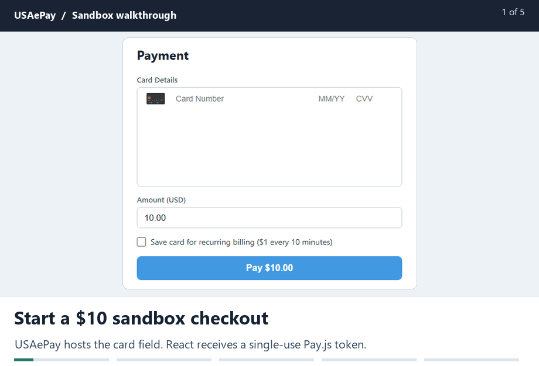
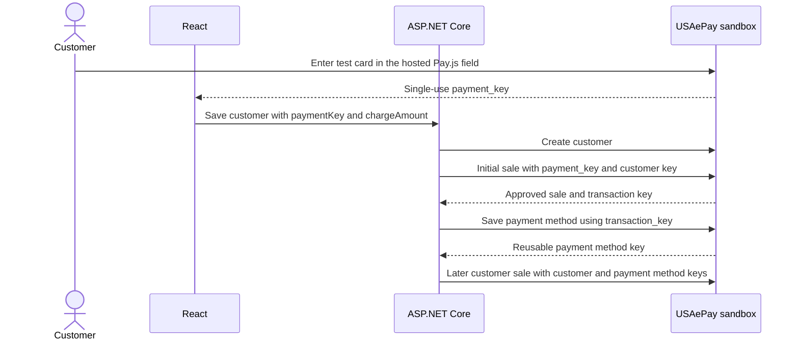

# USAePay payments with ASP.NET Core and React

Charge a card once, save its payment method, then bill the same customer again in the USAePay sandbox. React uses the hosted Pay.js v1 card field. The ASP.NET Core 10 API receives a single-use token and calls the USAePay REST API v2.

**[Watch the 60-second walkthrough](#walkthrough) · [Run the sandbox with Docker](#run-the-sandbox-with-docker)**

## Walkthrough



Select **Save card for recurring billing**, enter a fictitious customer, and submit the initial payment. Open **Recurring**, select **Force Billing**, and expand the customer to see the separate $1 charge.



Follow the implementation through the [React payment form](frontend/src/components/PaymentForm.jsx), [C# gateway calls](backend/USAePayPortal/Services/USAePayService.cs), and [recurring worker](backend/USAePayPortal/BackgroundServices/RecurringPaymentService.cs). USAePay hosts card entry and tokenizes the card. [Pay.js v1 reference](https://help.usaepay.com/developer/payjs-v1/)

## Run the sandbox with Docker

You need Docker with Compose and a USAePay sandbox merchant account. In the sandbox merchant console, open **Settings → API Keys**, create a server API key with a PIN, then select **Add Public API Key** for the browser. [Request a sandbox account](https://help.usaepay.info/developer/reference/sandbox/) · [Merchant console key setup](https://help.usaepay.com/merchant/guide/settings/api-keys/)

1. Clone this repository and open its directory.

   ```sh
   git clone https://github.com/AlexanderAnishchik/usaepay-demo-payments.git
   cd usaepay-demo-payments
   ```

2. Copy `docker.settings.example.env` to `docker.settings.env`. Set `USAePay__ApiKey`, `USAePay__Pin`, and `USAePay__PublicApiKey` in your copy. The template already selects the sandbox API and the local frontend URL.

   ```sh
   cp docker.settings.example.env docker.settings.env
   ```

3. Start the app.

   ```sh
   docker compose up --build -d
   ```

4. Open [the checkout](http://localhost:3000) and try a test card below. The [interactive API reference](http://localhost:5000/scalar/v1) and [OpenAPI document](http://localhost:5000/openapi/v1.json) are also available with the template's Development environment.
5. Stop the demo with `docker compose down`. The worker bills enrolled customers $1 every ten minutes while the backend is running. **Force Billing** immediately bills every locally enrolled customer. Restarting the backend clears local enrollment and history. Removing a customer in the dashboard leaves the sandbox vault record in place.

### Sandbox test cards

| Scenario | Card number | Expiration | CVV |
| --- | --- | --- | --- |
| Approval | `4000 1000 1111 2224` | `12/30` | `123` |
| Decline | `4000 3000 1111 2220` | `12/30` | `999` |

These two cases were exercised through the hosted Pay.js field. The first produced an approved sale and a reusable payment method. The second returned a decline for a one-off payment. To reproduce the decline, leave **Save card for recurring billing** unchecked and click **Pay**. [USAePay sandbox test cards](https://help.usaepay.com/developer/reference/testcards/)

## Run the app natively

Use the .NET 10 SDK, Node.js 22, and the same sandbox credentials. Copy `backend/USAePayPortal/appsettings.example.json` to `backend/USAePayPortal/appsettings.json`. Set `ApiKey`, `Pin`, and `PublicApiKey` under `USAePay`.

In one terminal at the repository root:

```sh
dotnet run --project backend/USAePayPortal
```

In a second terminal:

```sh
cd frontend
npm ci
npm run dev
```

Open [the Vite checkout](http://localhost:5173). Vite forwards `/api` requests to port 5000.

## API examples

For a one-off charge, React sends the token to `POST /api/payment/charge` using the app's camel-case field:

```json
{ "paymentKey": "<fresh Pay.js token>", "amount": 10.00 }
```

The backend sends the token to the gateway's `POST /api/v2/transactions` using USAePay's field name:

```json
{ "command": "cc:sale", "payment_key": "<same token>", "amount": "10.00", "description": "Portal charge" }
```

| App route | Purpose |
| --- | --- |
| `GET /api/payment/config` | Read the public Pay.js configuration |
| `POST /api/payment/charge` | Make a one-off charge |
| `POST /api/payment/customers` | Create a customer, take the initial payment, and save the payment method |
| `GET /api/payment/recurring` | Read enrolled customers and their recurring charge history |
| `POST /api/payment/recurring/run` | Run a $1 billing cycle for all enrolled customers |
| `DELETE /api/payment/customers/{customerKey}` | Remove a customer from local billing |

If the initial payment succeeds and saving the card then fails, `POST /api/payment/customers` returns HTTP `422` with `initialCharge.success` set to `true` and the transaction reference when available. **The initial payment went through.** Use its reference to reconcile the sale. Submitting the checkout again would initiate another payment.

## Run the tests without gateway credentials

From the repository root:

```sh
dotnet test USAePayPortal.sln
cd frontend
npm ci
npm test
npm run build
```

The API tests exercise the payment routes against a simulated gateway. The React tests submit the form and verify that dismissing a partial-payment warning sends no additional request.

[MIT license](LICENSE)
